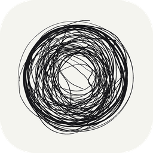

<p align="center">
  
</p>

<h1 align="center">Scrawl</h1>

<p align="center">
  Write markdown, sketch diagrams, and keep it all in one folder.<br>
  A lightweight native desktop app, built with Qt 6 and C++.
</p>

<p align="center">
  <strong>Status: in progress.</strong> Early skeleton, not ready for daily use.
</p>

---

## Why

Writing technical notes and design answers usually means juggling a markdown editor, a whiteboard tool, and a diagram previewer, and most of them are Electron apps. Scrawl is an attempt at one small native app that opens a folder like a code editor and handles all three.

## Build

Requirements: CMake 3.21+, a C++20 compiler, and Qt 6 (Widgets). KSyntaxHighlighting (KF6) is optional and enables code highlighting.

```
cmake -S . -B build -G Ninja
cmake --build build
./build/scrawl
```

On Ubuntu: `sudo apt install cmake ninja-build qt6-base-dev`, and optionally `libkf6syntaxhighlighting-dev`.

## Use

- `Ctrl+Shift+O` opens a folder
- Double click a file in the tree to open it
- `Ctrl+S` saves, `Ctrl+W` closes the tab

## License

MIT. See [LICENSE](LICENSE).
